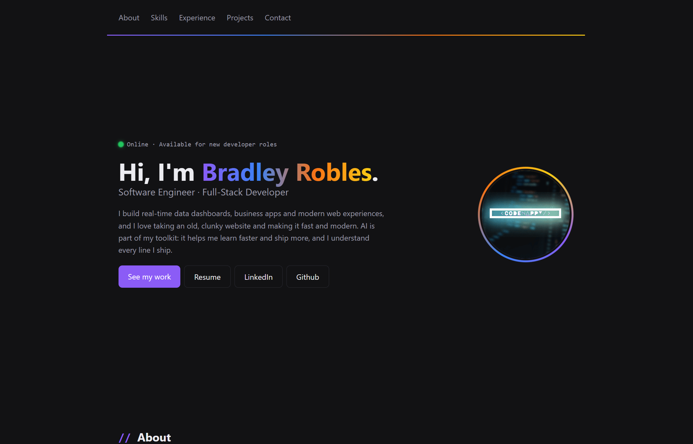

# Bradley Robles · Developer Portfolio

My personal portfolio site, hand-coded from scratch with HTML, CSS and JavaScript.

**Live site:** https://codehappy753.github.io/Portfolio/

## About

I'm a software engineer and full-stack developer who builds real-time data dashboards, business apps and modern web experiences. This site is where I share my projects as I build them.

## Features

- Responsive layout for desktop, tablet and phone using Flexbox, CSS Grid and media queries
- Sticky header with an animated gradient line
- Profile photo with a spinning gradient ring
- Glowing status lights on project cards (Live, Up Next, In Progress)
- Swipeable button row on phones
- Custom scrollbars that match the site's theme
- Footer year updated automatically with JavaScript

## Built with

- HTML5
- CSS3 (custom properties, Flexbox, Grid, keyframe animations)
- JavaScript
- Hosted on GitHub Pages

## Contact

- LinkedIn: https://www.linkedin.com/in/bradley-robles
- GitHub: https://github.com/CodeHappy753
